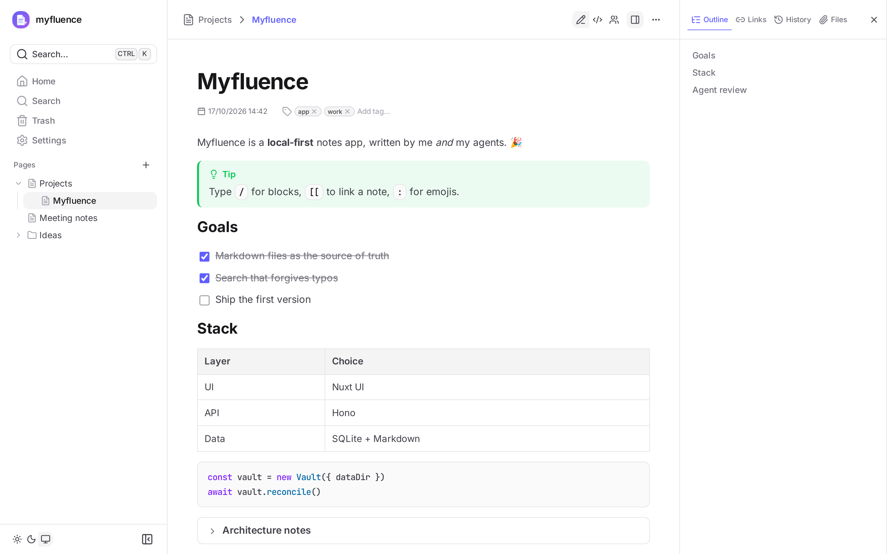

# Tandem

Local notes, written by you **and** your agents.

Tandem is a note-taking app that runs on your computer (macOS or Linux) and keeps everything
in one folder of plain Markdown files — typically inside OneDrive, so your notes are synced and backed
up. You write in a rich editor; agents (Claude Code, Claude Desktop, scripts) write through an
MCP server or a CLI, and every line remembers who wrote it.



## Features

- **Rich editor that writes Markdown**: headings, lists, to-dos, tables, code with highlighting,
  Mermaid diagrams, callouts, collapsible sections, emojis, links, resizable images. `/` for
  blocks, `[[` to link a note, `:` for emojis, a raw Markdown mode when you need it.
- **Autosave** in the background, with conflict detection when an agent edits the same note.
- **Pages in a tree** (pages can have child pages), with drag and drop, tags, breadcrumbs, and
  icons (an emoji or an image) for any page or folder.
- **Files**: drop or paste a file anywhere in a note; it is copied next to the note
  (`Note.assets/`) and shown as an image or a file chip.
- **Search** (`⌘⇧F`): prefixes, accents ignored, typos corrected, `"phrases"`, `-word`,
  `tag:x`, `in:Folder`, attachment names.
- **History** of every note (a version per editing session and per author), with diffs and
  restore; **authorship** of each line (you, an agent, or an external edit).
- **Trash** with restore and permanent delete.
- **For agents**: an MCP server and a CLI with the same operations.
- Light, dark or system theme; background tone (white, paper, sepia, cool); accent color, gray tone, corner radius, editor font, width and text size.
- Installable as an app with its own window and Dock icon.

## Install

```bash
curl -fsSL https://raw.githubusercontent.com/ddahan/tandem/main/install.sh | sh
```

That's all: no Docker, no Node. The installer downloads Tandem (one executable, for macOS or
Linux, Apple Silicon or Intel), checks it, asks where your notes live (default `~/Tandem`; a
OneDrive or iCloud folder works), starts it at login, and opens <http://localhost:3000>.

- **Update**: run the same command again (your notes folder is remembered).
- **Uninstall**: `… | sh -s -- --uninstall` (your notes stay).
- Options, as environment variables: `TANDEM_DATA_DIR`, `TANDEM_PORT`, `TANDEM_BIN_DIR`. Logs:
  `~/Library/Logs/Tandem.log` (macOS), `journalctl --user -u tandem` (Linux).
- With OneDrive, right-click the folder in Finder → **Always Keep on This Device**.

### With Docker instead

Requires [Docker Desktop](https://www.docker.com/products/docker-desktop/) and a clone of this
repository:

```bash
cp .env.example .env     # then set TANDEM_DATA_DIR to your notes folder
./td start               # builds and starts the app
```

Open <http://localhost:3000>. The app restarts with Docker; `./td stop` stops it and
`./td logs` shows its output. After pulling changes, `./td start` rebuilds. Docker can't read
OneDrive's online-only files: keep the folder on the device.

### As a Mac app

- **Safari**: open <http://localhost:3000>, then **File → Add to Dock**.
- **Chrome**: open it, then **⋮ → Cast, save and share → Install page as app**.

It then opens in its own window, with the Tandem icon in the Dock.

## Agents

### MCP (Claude Code, Claude Desktop, any MCP client)

```bash
claude mcp add --transport http tandem http://localhost:3000/mcp --header "X-Tandem-Author: claude"
```

The header names the agent in the history and authorship views. Tools: `search_notes`,
`list_notes`, `read_note`, `create_note`, `create_folder`, `append_to_note`, `replace_in_note`,
`write_note`, `rename_note`, `move_note`, `delete_note`, `set_tags`, `set_icon`, `list_tags`,
`note_history`, `read_version`, `attach_file`.

### CLI

Installed with the installer, Tandem is also the `tandem` command. With Docker, `bin/tandem`
runs the CLI inside the running container; put it on your `PATH` once:

```bash
ln -s "$PWD/bin/tandem" /usr/local/bin/tandem
```

```bash
tandem search "roadmap tag:work"
TANDEM_AUTHOR=claude tandem append "Projects/Roadmap" "- [ ] Write the docs"
tandem attach "Projects/Roadmap" ~/Desktop/diagram.png --insert
tandem --help
```

See [docs/agents.md](docs/agents.md) for everything agents need to know (and paste into their
instructions).

## Your data

```
<your notes folder>/
  Projects.md                 a page
  Projects/                   its child pages
    Roadmap.md
    Roadmap.assets/           Roadmap's attachments
  Ideas/                      a folder
  .tandem/
    tandem.db              backup of the app's database (refreshed every minute)
    history/<note id>/        past versions of notes
    icons/                    image icons of pages and folders
    trash/                    deleted notes
```

- Notes are plain Markdown, without front matter: readable and editable by any tool. Edits
  made outside the app (an agent, a text editor, Finder) are picked up live.
- Ids, tags, order, history and authorship are in a SQLite database outside the notes folder
  (`~/Library/Application Support/Tandem/` on macOS, `~/.local/share/tandem/` on Linux, a
  volume with Docker), backed up into `.tandem/tandem.db`. If it is lost, the backup is
  restored automatically on the next start; this is also how you move from Docker to the
  installer (or back): point the new one at the same notes folder.
- One computer at a time: don't run two Tandem instances on the same folder.

## Development

Everything goes through `./td` (run it alone for the list):

| Task                                                | Command                                                     |
| --------------------------------------------------- | ----------------------------------------------------------- |
| Dev servers with reload (localhost:3010)            | `./td dev`                                                  |
| Demo notes (while `./td dev` runs)                  | `./td pnpm --filter @tandem/server seed http://server:3011` |
| All checks (format, lint, build, types, unit tests) | `./td check`                                                |
| End-to-end tests (Playwright)                       | `./td e2e`                                                  |
| Unit tests of one package                           | `./td test server`                                          |
| Standalone executables (all platforms)              | `./td release`                                              |

### Releasing

`./td release` builds the executables into `packages/standalone/dist` (signed for macOS,
checked, with `SHA256SUMS`). Set the version in `packages/standalone/package.json`, then
publish them as a GitHub release; the installer always takes the latest one:

```bash
gh release create v0.1.0 packages/standalone/dist/tandem-* packages/standalone/dist/SHA256SUMS
```

Read [AGENTS.md](AGENTS.md) before changing the code, and [docs/](docs) for the specification
and the architecture.
